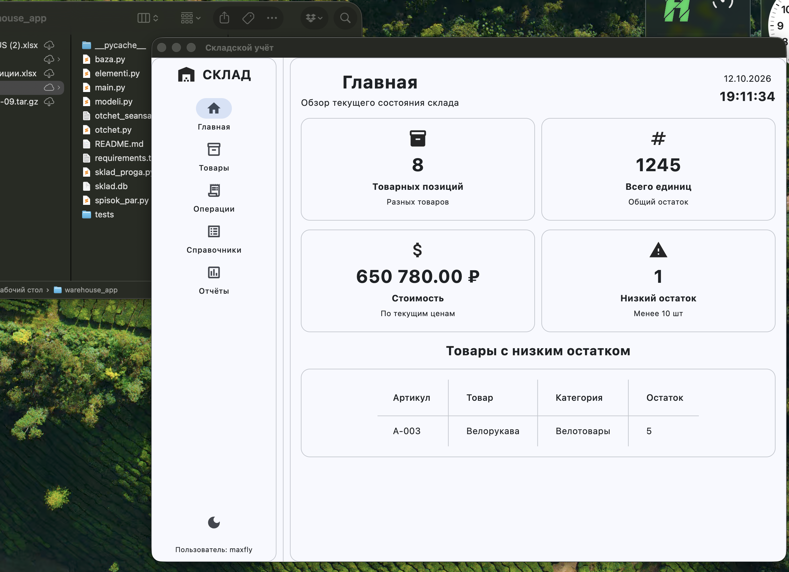
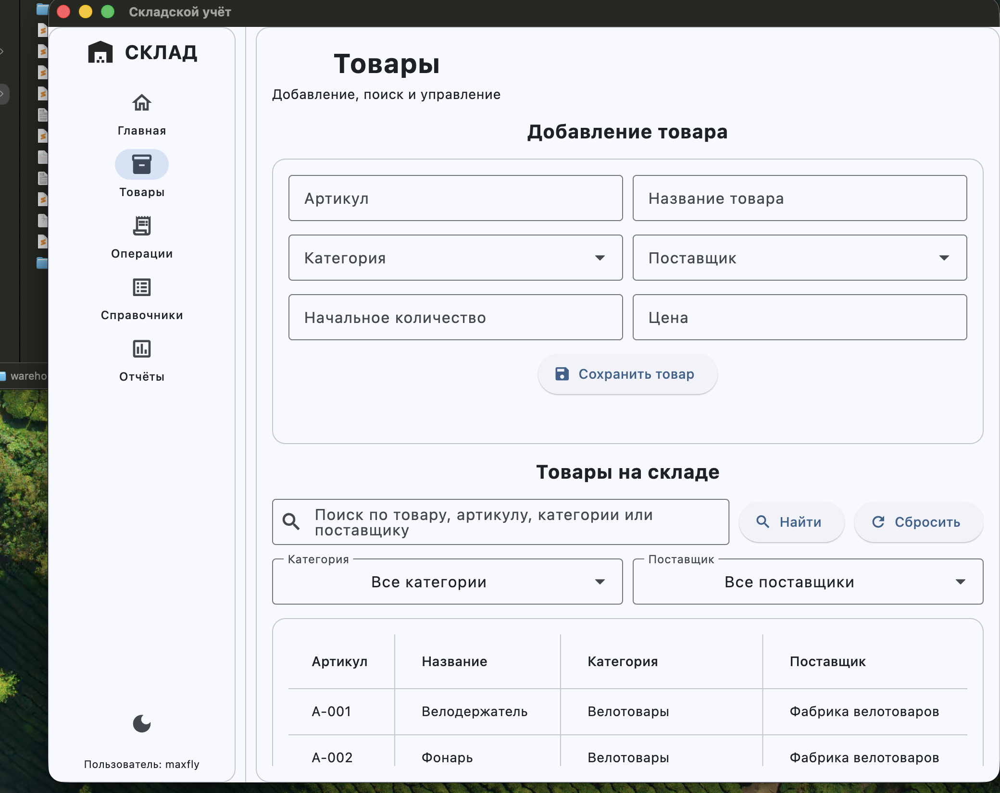
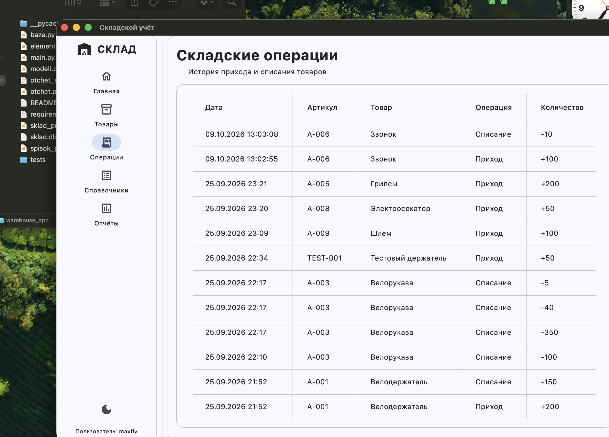

## что в программе

- добавление, изменение и удаление товаров
- категории и поставщики
- приход и списание
- поиск и фильтр
- история операций
- главная страница с остатками
- простые отчеты
- светлая и темная тема
- отчет со временем входа и выхода

## файлы

- `pyproject.toml` настройки проекта Flet
- `src/main.py` запускает программу
- `src/sklad_proga.py` главное окно и кнопки
- `src/modeli.py` классы товаров, категорий, поставщиков и операций
- `src/baza.py` работа с SQLite
- `src/spisok_par.py` класс для пар ключ и значение без dict
- `src/otchet.py` отчет о входе и выходе
- `src/elementi.py` элементы Flet
- `src/sklad.db` база данных
- `tests/test_proverka.py` проверка

## скриншоты

### главная

### товары

### операции

